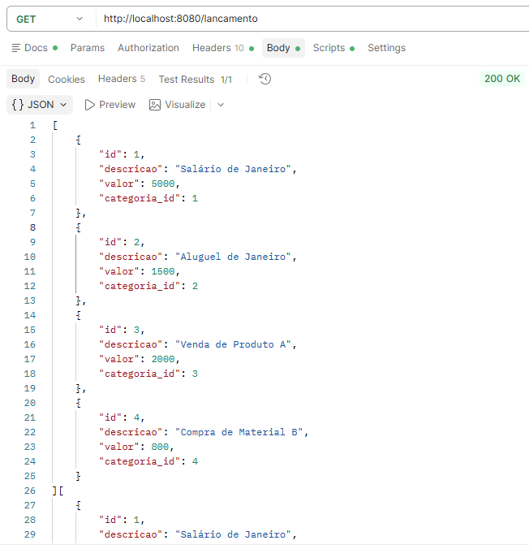
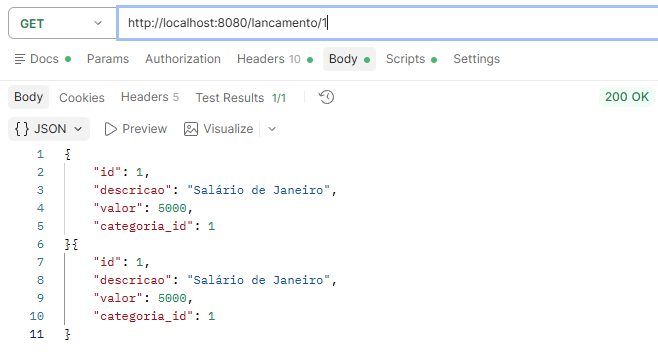
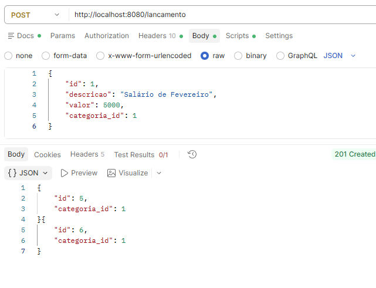
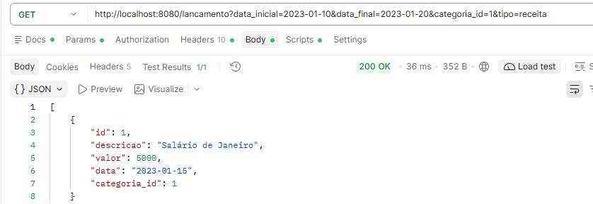
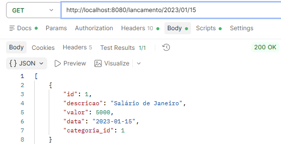
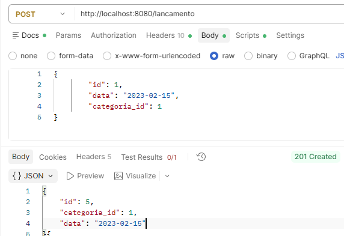
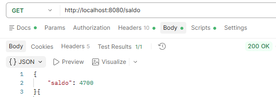
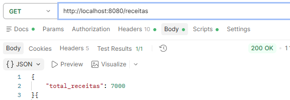

Nome do Curso: Informática
Nome da Unidade Curricular: Desenvolver Serviços Web
Nome do aluno: Davi Santana

API de teste com Slim PHP

## Configuração e execução

Requisitos: PHP com suporte a JSON, Composer e as dependências do projeto.

```bash
composer install
php -S localhost:8080 -t public
```

Com o servidor ativo, consulte `http://localhost:8080/status` ou execute:

```bash
curl -H "Accept: application/json" http://localhost:8080/status
```

Execute os testes automatizados e independentes dos dados do servidor com:

```bash
vendor/bin/phpunit tests/FinancaTest.php
```

Cada teste cria sua própria instância da aplicação e usa dados em memória.

## Endpoints

Todas as requisições com corpo devem enviar JSON (`Content-Type: application/json`).
As respostas com corpo são JSON; operações de exclusão bem-sucedidas retornam `204`
sem corpo.

| Método | Endpoint | Descrição |
|---|---|---|
| GET | `/status` | Verifica se a API está ativa |
| GET | `/categoria` | Lista categorias |
| GET | `/categoria/{id}` | Consulta uma categoria |
| POST | `/categoria` | Cria categoria com `nome` e `tipo` |
| PUT | `/categoria/{id}` | Atualiza `nome` e `tipo` de uma categoria |
| DELETE | `/categoria/{id}` | Exclui categoria sem lançamentos associados |
| GET | `/lancamento` | Lista lançamentos; aceita filtros abaixo |
| GET | `/lancamento/{id}` | Consulta um lançamento |
| GET | `/lancamento/{ano}/{mes}/{dia}` | Consulta lançamentos de uma data |
| POST | `/lancamento` | Cria lançamento |
| PUT | `/lancamento/{id}` | Atualiza um lançamento |
| DELETE | `/lancamento/{id}` | Exclui um lançamento |
| GET | `/saldo` | Consulta saldo (receitas menos despesas) |
| GET | `/receitas` | Consulta total das receitas |

Filtros combináveis de `GET /lancamento`: `data_inicial`, `data_final`
(formato `AAAA-MM-DD`), `categoria_id` e `tipo` (`receita` ou `despesa`).

Exemplos de corpos JSON:

```json
{
   "nome": "Investimentos",
   "tipo": "receita"
}
```

```json
{
   "descricao": "Aplicação mensal",
   "valor": 250.50,
   "data": "2026-11-10",
   "tipo": "receita",
   "categoria_id": 1
}
```

Um lançamento precisa de `categoria_id`, `valor`, `data` e `tipo`. O valor deve
ser numérico e maior que zero; a data deve existir no calendário e seguir
`AAAA-MM-DD`; o tipo deve ser igual ao tipo da categoria. Nomes de categoria
duplicados (ignorando espaços nas pontas e maiúsculas/minúsculas) são rejeitados.
Falhas de validação retornam JSON com a chave `erro` e status `400` ou `422`;
recursos inexistentes retornam `404`, conflitos de regra de negócio `409`.

-Get /status


-Get /categoria


-Get /categoria/{id}


-Get /lancamento


-Get /lancamento/{id}


-Put /categoria/{id}
-Body -Raw
{
    "nome": "Aaa",
    "tipo": "despesa"
}


-Put /lancamento/{id}
-Body -Raw
{
    "descricao": "Salário de Fevereiro",
    "valor": 5000,
    "data": "2023-02-01",
    "tipo": "receita",
    "categoria_id": 1
}


-delete /categoria/{id}


`GET /lancamento` aceita filtros combináveis por período, categoria e tipo:

- `data_inicial` e `data_final`: datas no formato `AAAA-MM-DD` (inclusive).
- `categoria_id`: ID da categoria.
- `tipo`: `receita` ou `despesa` (tipo definido pela categoria).

Exemplo: `GET /lancamento?data_inicial=2023-01-10&data_final=2023-01-20&categoria_id=1&tipo=receita`.

ou
Exemplo: `GET /lancamento/2023/01/15`


Envie o campo `data` no `POST /lancamento`, no formato `AAAA-MM-DD`.


Para criar ou atualizar uma categoria, envie `nome` não vazio e `tipo` como `receita`
ou `despesa`. A criação de lançamento exige `categoria_id`, `valor`, `data` e `tipo`
válidos conforme as regras acima. Os testes cobrem sucesso, falhas de validação,
conflitos de regra de negócio e identificadores inexistentes.

Resulmo dos resultados
-Get /saldo


-Get /receitas

